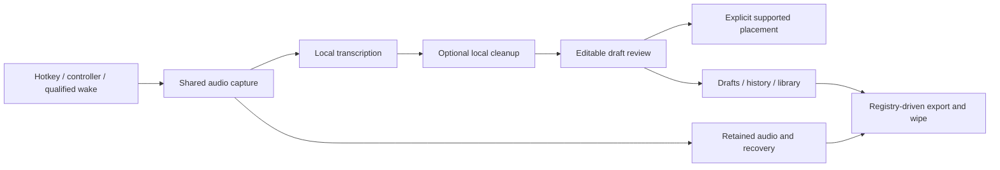

# BetterFingers — Consolidated Feature Design and Completion Plan

Consolidated: **2026-09-06**. Scope: the repository's product, design, UI, QA, release, security, tutorial, and marketing documentation, including historical plans where they preserve requirements. This is a synthesis and planning document, not a concatenation of contradictory snapshots.

**Product:** a local-first desktop speech editor: activate → record → transcribe → optionally refine → review → place text → retain a recoverable result. The user remains in control of meaning, microphone access, storage, and delivery.

**Primary objective:** make that loop dependable on a defined Windows 11 configuration before expanding the feature set. An implemented feature, an enabled interface, a successful unit test, and a qualified public artifact are four different facts.

## 1. How to use this document

This is the working overview for feature planning. Original documents remain intact as specifications, policies, historical evidence, packaging inputs, and detailed runbooks. This consolidation does not replace the security policy, model-license records, release support contract, or exact artifact evidence.

Each feature has the same fields:

- **Purpose and contract:** the user outcome and boundaries to preserve.
- **Status and evidence:** implemented behavior, visible availability, and qualification limits.
- **Failure points:** documented limitations or historical regressions, plus explicitly identified risks to exercise. A risk is not a newly reproduced defect.
- **Work remaining:** implementation, reconciliation, or qualification work; no item authorizes its own execution.
- **Testing needed:** the meaningful checks that can close the gap. Listed test files are existing starting points, not tests run for this document.
- **Polish required:** proposed usability improvements or operator requests. Cosmetic work never substitutes for correctness.
- **Done when:** observable acceptance, scoped to the feature and target environment.

Status terms: **Implemented** = source/evidence exists; **Local-only** = later development work not attributed to the documented public build; **Hidden** = the current alpha surface disables the named control; **Gated** = a policy/qualification decision remains; **Unqualified** = the required live evidence is missing; **Planned** = intended work without accepted completion here; **Reconcile** = older requirement needs a targeted current-code check; **Parked** = outside active scope.

Work order: **NOW** protects the core loop and release truth; **NEXT** completes useful existing subsystems after that gate; **LATER** is expansion. These priorities are recommendations in this plan, not evidence that work has started.

### 1.1 Evidence precedence and snapshot limits

1. For current checkout availability, inspect production composition and capability flags; a reachable-looking HTML node or a `wired` ledger row alone is insufficient.
2. For accepted implementation decisions, use the relevant later ruling in [DECISIONS](release/DECISIONS.md) and its recorded evidence.
3. For the documented public build and platform promises, use [SUPPORTED_PLATFORMS](release/SUPPORTED_PLATFORMS.md), [RELEASE_BOARD](release/RELEASE_BOARD.md), and [KNOWN_LIMITATIONS](release/KNOWN_LIMITATIONS.md).
4. Use [DESIGN](../DESIGN.md), [ACCOMPLISH](../ACCOMPLISH.md), UI specifications, and archive plans for requirements, not automatic current-status authority.
5. Marketing copy and old test counts cannot promote a capability. A generated QA report proves only its recorded run and harness.

The release board and limitations were last reviewed **2026-08-27**. They record public **v1.1.0-alpha.3**, signed Windows x64 NSIS and experimental Linux AppImage, separately from later local stabilization. This consolidation did not query GitHub, install a package, run product tests, or perform hardware qualification. Public/live state must be refreshed before publication; no new release-readiness claim is made here.

### 1.2 Current alpha availability must accompany implementation status

Source check: [alphaCapabilities.js](../app/src/renderer/config/alphaCapabilities.js), applied by [signalDeskApp.js](../app/src/renderer/bootstrap/signalDeskApp.js).

| Capability flag | Value at consolidation | Consequence |
|---|---|---|
| `voiceCloning` | false | The named legacy/custom-cloning panels are hidden and inert. Runtime implementation is not an enabled feature claim. |
| `teachFromEdits` | false | Talk/Studio teaching panels are hidden. |
| `wakeWordSettings` | false | The named wake backbone/settings groups are hidden; this does not by itself classify every newer setup route. |
| `workflowSettings` | false | General workflow-settings group is hidden. Assess separately any specialized Game Night entry point. |
| `personaStressTest` | false | Old Persona Studio stress-test surface is hidden. |
| `deprecatedVoiceDeliveryCards`, `deprecatedPersonaActions` | false | Deliberate retired surfaces; do not restore merely to improve a parity count. |
| `structuredPersonaEditor`, `customVoiceWorkflow`, `scribeLongInputBatching` | true | Enabled flags; live behavior still needs its own qualification. |

The [production QA report](../app/tests/qa/out/signal-desk-prod/qa-report.md) explicitly skips scenarios for hidden capabilities. The [parity ledger](release/PARITY_INVENTORY.md) records **404 wired / 34 intentional cuts / 0 blocked / 438 total**. That is source/test anchoring, not 404 enabled features, individual accessibility certification, or a completion percentage.

### 1.3 Feature navigation

| Area | Feature sections |
|---|---|
| Capture and generation | [F01 Startup, sidecar health, and runtime readiness](#f01) · [F02 Consent, first-run setup, and replayable tutorial](#f02) · [F03 Microphone recording and long capture](#f03) · [F04 Global hotkeys and shared input actions](#f04) · [F05 Local transcription and speech-model quality](#f05) · [F06 Optional local LLM cleanup and preservation](#f06) · [F07 Long-input batching, chunking, and stitching](#f07) · [F08 Personal dictionary and correction learning](#f08) · [F09 Voice macros, formatting commands, and sign-offs](#f09) · [F10 Voice editing and application commands](#f10) |
| Review and writing | [F11 Draft review and Review Deck](#f11) · [F12 Confidence policy and Auto Submit](#f12) · [F13 Paste/injection, clipboard restoration, and target compatibility](#f13) · [F14 Selection rewrite and selected-text read-aloud](#f14) · [F15 Message Rescue, context, variants, and clarification](#f15) · [F16 Scribe and text/persona playground](#f16) · [F17 Draft Library, history, search, and reusable material](#f17) · [F18 Audio retention, retry, and failure recovery](#f18) |
| Personas and contacts | [F19 Persona editor, Foundry, and active preset](#f19) · [F20 Teach from edits and approved persona examples](#f20) · [F21 Contacts and explicit draft association](#f21) · [F22 Audience context and speech-delivery signals](#f22) · [F23 Persona traits and prompt effects](#f23) |
| Voice and audio | [F24 TTS read-aloud and playback lifecycle](#f24) · [F25 Custom Voice, blends, modulation, and presets](#f25) · [F26 Voice cloning and optional conversion runtime](#f26) · [F27 Wake phrase setup, training, and live detection](#f27) · [F28 Audio ducking, push-to-mute, and capture isolation](#f28) |
| Apps and devices | [F29 Per-application profiles and gaming policy](#f29) · [F30 Approved launch workflows and Game Night](#f30) · [F31 Controller bindings and game setup](#f31) · [F32 Stream Deck adapter](#f32) · [F33 MCP connections and future tool execution](#f33) |
| Models and data | [F34 Model catalog, downloads, runtime compatibility, and provenance](#f34) · [F35 Job management, cancellation, and model resources](#f35) · [F36 Settings, profiles, import/export, and migration](#f36) · [F37 Privacy registry, retention, export, wipe, and encryption](#f37) · [F38 Runtime Diagnostics, support report, and latency probes](#f38) · [F39 In-app bug reporting and optional relay](#f39) · [F40 Shell, overlays, appearance, and accessibility](#f40) |
| Engineering and delivery | [F41 Security boundaries, upload safety, and log hygiene](#f41) · [F42 Architecture, storage ownership, and maintainability](#f42) · [F43 Packaging, signing, installation, and updates](#f43) · [F44 Platform and acceleration support](#f44) · [F45 Public documentation, demo, support, and tester activation](#f45) · [F46 Parked feature families and research](#f46) |

## 2. Product boundaries and architecture

- Core STT, cleanup, and TTS run locally. Downloads, update checks, and explicitly reviewed reports are separate network activities. Do not promise unconditional offline operation.
- AI cleanup is optional and off on a fresh install. Choosing a larger model must be deliberate, with costs and compatibility disclosed.
- Preserve names, numbers, dates, negation, commitments, and the speaker's stated intensity. Review remains necessary even when a confidence score is high.
- Selected text and user-entered context are untrusted input. They never authorize tool execution, recipient inference, or automatic sending.
- Contacts are created, named, and selected by the user. No inferred recipient from the active app or window title.
- No concealed always-listening state, automatic training from messages, or destructive voice action without the required confirmation. Emergency stop must remain available.
- Data deletion must quiesce writers and verify postconditions. Failed cleanup must be reported, not relabelled success.
- Platform support is exact and evidence-bound. No universal game, GPU, desktop, microphone, or model guarantee.

Electron main owns windows, tray, privileged IPC, hotkeys and desktop interaction; the renderer presents state and user decisions; Python owns model runtimes, speech processing, domain rules and data. The boundary is an authenticated, versioned REST/WebSocket bridge. Keep privileged operations in the trusted boundary and preserve the current Electron/vanilla-renderer architecture. A framework rewrite is not part of this plan.

## 3. Startup, capture, and text generation

### F01 — Startup, sidecar health, and runtime readiness

- **Purpose and contract:** reach a usable Talk screen with truthful readiness and a recoverable failure path.
- **Status and evidence:** implemented health/version handshake, restart handling and startup state surfaces. Historical OR-02/03/04 fixes have automated evidence; clean-machine timing remains unqualified. [DESIGN §2–3](../DESIGN.md), [startup spec](release/SPLASH_SPEC.md), [operator review](release/OPERATOR_REVIEW.md).
- **Failure points:** historical false Listening/Always On indicators; risks include occupied backend port, wrong executable, slow model startup, stale service state and crash/restart loops.
- **Work remaining — NOW:** verify startup on a clean CPU-only target and distinguish backend readiness from optional model readiness. Retain main-process ownership of failure; a UI timer may report slow, not invent failure.
- **Testing needed:** [sidecar lifecycle tests](../app/tests/sidecarLifecycle.test.mjs), [lazy-startup tests](../tests/test_server_lazy_startup.py); real delayed startup, failed launch, retry, restart and stale-instance scenarios. Record the 50-restart reliability run separately.
- **Polish required:** one actionable reason and Retry/Diagnostics path; reduced motion; no fictitious progress or machine specifications.
- **Done when:** a fresh user reaches real readiness or an actionable failure, and recovery leaves one functioning backend without losing drafts.

### F02 — Consent, first-run setup, and replayable tutorial

- **Purpose and contract:** obtain mandatory consent, then help the user complete their first dictation without requiring persona creation or an LLM.
- **Status and evidence:** consent-guided flow implemented; a separate seven-step Quick Setup tour exists with skip/replay/versioned persistence. [guided flows](ui/SIGNAL_DESK_GUIDED_FLOWS.md), [Quick Setup source](../app/src/renderer/features/quickSetupTour.js). The packaged [tutorial script](../Tutorial_Script.txt) contains older terminology and controls.
- **Failure points:** historical Escape/focus leakage and silent model download; risks include tour overlays colliding with consent, inaccessible targets and old narration teaching removed actions.
- **Work remaining — NOW:** reconcile tutorial copy with current navigation and hotkey names; verify fresh, migrated and completed profiles. Preserve consent as mandatory while allowing the tutorial to be skipped.
- **Testing needed:** [onboarding consent](../app/tests/onboardingConsent.test.mjs), [onboarding flow](../app/tests/onboardingFlow.test.mjs), [tour tests](../app/tests/quickSetupTour.test.mjs); keyboard-only Back/Next/Skip/Replay, restart persistence and first-run model failure.
- **Polish required:** short cards, clear model-download size/progress, visibly focused targets, and explicit separation of global bindings from the app-local `?` shortcut sheet.
- **Done when:** a new user can consent, select the minimum speech model and complete one reviewed dictation with no dead end; replay never re-enrolls consent or changes settings unexpectedly.

### F03 — Microphone recording and long capture

- **Purpose and contract:** record usable audio through hold/toggle activation, expose actual capture state, and retain successful recordings for recovery.
- **Status and evidence:** implemented recording, amplitude/no-audio gate, trailing-silence auto-stop, watchdog and shared audio input. Hardware behavior remains experimental. [DESIGN §6](../DESIGN.md), [support contract](release/SUPPORTED_PLATFORMS.md).
- **Failure points:** wrong/default device, unplug/replug, stale device identifiers, clipped first word, long silence, missed key release, sleep/resume and disk exhaustion. These are test risks; not all are current defects.
- **Work remaining — NOW:** run the primary microphone matrix and 5/15/30/60-minute captures; document device fallback and stop reasons.
- **Testing needed:** [audio-device resolver](../tests/test_audio_device_resolver.py), [audio gate](../tests/test_audio_gate.py), [shared broker](../tests/test_audio_input_broker.py), [auto-stop](../tests/test_auto_stop_silence.py); physical unplug/replug and deliberate default-device changes.
- **Polish required:** understandable input meter, System Default first, explicit silent/clipped input guidance and visible capture duration.
- **Done when:** all stop paths release capture, recoverable audio survives later processing failure, and the tested devices work after reconnect and restart.

### F04 — Global hotkeys and shared input actions

- **Purpose and contract:** one input intent produces one action; global recording/emergency/selection bindings remain distinct from focused-window editing shortcuts.
- **Status and evidence:** global hotkeys, controller action namespace and binding/dispatch contracts exist. A broader `InputCoordinator` remains an old architecture requirement to reconcile, not grounds to duplicate the existing dispatcher. [WAVE10_QA](release/WAVE10_QA.md), [DESIGN M6](../DESIGN.md).
- **Failure points:** rebind collisions, keyboard auto-repeat, gamepad-plus-keyboard double start, held modifier capture, missed key-up, disabled adapters blocking emergency stop and hooks surviving shutdown.
- **Work remaining — NOW:** qualify the supported Windows bindings and focus transitions; NEXT reconcile remaining coordinator gaps against existing code.
- **Testing needed:** [input dispatch](../tests/test_input_dispatch.py), [input binding](../tests/test_input_binding.py), [local shortcuts](../app/tests/shortcuts.test.mjs); hold/release, disable/re-enable, rebinding while focused in text and application shutdown.
- **Polish required:** collision messages naming the conflicting action; accessible binding capture; a clear global-versus-local shortcut guide.
- **Done when:** one action fires per intended input, held states always release and emergency stop works under every supported adapter state.

### F05 — Local transcription and speech-model quality

- **Purpose and contract:** transcribe speech locally and expose uncertainty without representing a model score as proof of correctness.
- **Status and evidence:** faster-whisper/CTranslate2 path implemented; model/cache mapping fixes are recorded. Alternative STT engines and a full real-audio accuracy suite remain roadmap/reconciliation work. [README](../README.md), [operator review](release/OPERATOR_REVIEW.md), [DESIGN M5](../DESIGN.md).
- **Failure points:** wrong words with apparently acceptable confidence, accents/noise, model/runtime mismatch, nonexistent model IDs, blank speech output and unusable CPU latency.
- **Work remaining — NOW:** establish one measured CPU baseline and representative audio corpus. NEXT qualify other models individually; do not advertise catalog presence as functioning integration.
- **Testing needed:** real WER and preservation measurements across noise, silence, repetitions and domain terms; cache rediscovery after restart; disabled/missing model and interrupted download. Keep speech-signal synthetic fixtures separate from acoustic benchmarks under [TEST_DATA_POLICY](TEST_DATA_POLICY.md).
- **Polish required:** explain speed/accuracy/storage tradeoffs in plain language and give useful no-input guidance.
- **Done when:** the named model/hardware pair passes a declared corpus and performance bar, with failures visible and recoverable.

### F06 — Optional local LLM cleanup and preservation

- **Purpose and contract:** clean grammar, tone and formatting while preserving meaning; basic dictation works without cleanup.
- **Status and evidence:** local llama.cpp cleanup, active-persona resolution, scaled timeouts, empty-output fallback and heartbeat implemented. [DESIGN §3](../DESIGN.md), [preservation baseline](release/PRESERVATION_BASELINE.md).
- **Failure points:** historical timeout returning raw text silently, empty completion erasing usable speech and ignored persona selection; ongoing risks include changed numbers/negation, hallucinated commitments, refusals and prompt injection from source text.
- **Work remaining — NOW:** qualify actual installed model/runtime combinations; make fallback-to-raw distinguishable from successful cleanup. Retain optional/off-by-default setup.
- **Testing needed:** [empty-output guard](../tests/test_llm_empty_output_guard.py), [timeout](../tests/test_api_timeout.py), [preset resolution](../tests/test_dictation_preset_resolution.py); repeated real-model preservation across names, dates, quantities, commitments and adversarial instructions.
- **Polish required:** show input/output/persona and truthful busy/fallback state; cancellation must not discard the raw transcript.
- **Done when:** the declared corpus passes without loss of material facts and failures preserve reviewable input rather than pretending cleanup succeeded.

### F07 — Long-input batching, chunking, and stitching

- **Purpose and contract:** handle long speech/text without truncation, duplicated seams, hidden limits or frozen-looking progress.
- **Status and evidence:** sentence/paragraph chunking, overlap-as-context, per-persona token limits, progress and failure-safe seam stitching documented; Scribe long-input batching enabled. [DESIGN §3](../DESIGN.md), [alpha flags](../app/src/renderer/config/alphaCapabilities.js).
- **Failure points:** lost/duplicated boundary sentences, context leakage, confusing input versus completion budgets, cancellation midway and a failed stitch replacing usable chunks.
- **Work remaining — NOW:** include long inputs in reliability qualification; reconcile UI limits with actual runtime/model context.
- **Testing needed:** inputs just below/above chunk thresholds, paragraph/code/list boundaries, multi-chunk cancellation, stitch failure, low-memory behavior and real 60-minute recording output.
- **Polish required:** separate stage/chunk progress from estimates; explain long-draft review and token limits without model jargon.
- **Done when:** completed material survives every chunk and cancellation boundary, with explicit partial/recovered results and no automatic delivery of incomplete text.

### F08 — Personal dictionary and correction learning

- **Purpose and contract:** improve recognition of user-selected vocabulary through hotwords and correction handling.
- **Status and evidence:** dictionary, post-correction and edit-related learning are documented as implemented. Do not confuse dictionary behavior with the hidden persona-teaching panels. [DESIGN §3](../DESIGN.md), [dictionary tests](../tests/test_dictionary.py).
- **Failure points:** aggressive substitutions alter intended words, duplicate/case variants, corrupted stores and refresh errors falsely presenting an empty dictionary.
- **Work remaining — NEXT:** reconcile and document exactly when edits update the dictionary, what is persisted, and how users undo/remove learned terms.
- **Testing needed:** homophones, proper nouns, Unicode, case sensitivity, duplicate imports, malformed stores and failed refresh/save; regression checks that corrections do not rewrite unrelated words.
- **Polish required:** searchable entries, previewable corrections and useful import/validation errors.
- **Done when:** users can understand, inspect and reverse each vocabulary change and failed loads preserve the last valid view.

### F09 — Voice macros, formatting commands, and sign-offs

- **Purpose and contract:** expand explicit triggers and spoken formatting into predictable text without executing arbitrary commands.
- **Status and evidence:** macros, spoken punctuation/casing/paragraph formatting and sign-off settings are documented. [DESIGN §3](../DESIGN.md), [UI inventory](ui/CURRENT_UI_INVENTORY.md), [macro tests](../tests/test_macros.py).
- **Failure points:** overlapping triggers, literal dictation accidentally treated as a command, recursive expansion, unexpected sign-offs and malformed imported data.
- **Work remaining — NEXT:** reconcile trigger precedence and scope; preserve a literal-text escape and deterministic expansion limits.
- **Testing needed:** overlapping/case/Unicode triggers, formatting inside ordinary sentences, empty/very long expansions, corrupted stores and interactions with dictionary/persona cleanup.
- **Polish required:** try-before-save examples and clear distinction between text macros and launch workflows.
- **Done when:** the same trigger/context has a predictable bounded result and the user can speak a literal trigger without an unwanted action.

### F10 — Voice editing and application commands

- **Purpose and contract:** support scratch-that, replacement and structural edits with explicit context and confirmation rules.
- **Status and evidence:** parsers, preview logic, editing flags and pipeline wiring implemented; full hands-free behavior remains qualification work. [DESIGN §8](../DESIGN.md), [release decisions](release/DECISIONS.md).
- **Failure points:** ordinary speech misclassified as a command, destructive actions inferred from background audio, ambiguous context and confidence thresholds bypassing confirmation.
- **Work remaining — NEXT:** verify the enabled UI/command surface and complete a real wake→dictate→stop→review/confirm sequence before claiming hands-free operation.
- **Testing needed:** literal mode, background speech, ambiguous replacements, missing draft, negative commands, low confidence, repeated recognition and unconditional emergency stop.
- **Polish required:** preview the interpreted command without executing it; visible Needs confirmation / Cancel states.
- **Done when:** commands operate only in the intended context, destructive confirmation cannot be trained away and accidental speech cannot silently deliver content.

## 4. Review, writing, placement, and recovery

### F11 — Draft review and Review Deck

- **Purpose and contract:** edit, accept/decline, rerun cleanup and read a draft before placement; do not confuse accepting a draft with sending it externally.
- **Status and evidence:** production review surfaces, word-count/long-draft summary and TTS controls implemented. Historical Read/Stop defect recorded fixed. [parity ledger](release/PARITY_INVENTORY.md), [operator review](release/OPERATOR_REVIEW.md).
- **Failure points:** stale draft displayed/sent, duplicate accept, edits overwritten by late responses, stop button failing to stop audio and overlays losing keyboard focus.
- **Work remaining — NOW:** real end-to-end review/delivery qualification, including rapid navigation and late backend responses.
- **Testing needed:** edit while processing, accept twice, decline during playback, close/reopen overlay, long draft, backend restart and keyboard-only operation.
- **Polish required:** explicit Copy/Paste/Send wording matching the actual action; preserve text selection/caret and readable layout at high DPI.
- **Done when:** the exact reviewed draft is the only deliverable and cancellation or stale responses cannot replace the user's edits.

### F12 — Confidence policy and Auto Submit

- **Purpose and contract:** force review when confidence is missing/low or a draft is risky; clearly disclose when a setting presses Enter in another app.
- **Status and evidence:** policy implemented; historical OR-01 acknowledgement and OR-05 confidence work have later automated closure evidence. Hardware/model calibration remains open. [DESIGN §6.2](../DESIGN.md), [operator review](release/OPERATOR_REVIEW.md).
- **Failure points:** documented historical incorrect words passing the score and unwarned Enter; risks include changed focus, partial output, stale acknowledgement and confidence treated as semantic truth.
- **Work remaining — NOW:** qualify completed-output-only delivery, explicit acknowledgement and safe downgrade paths. Do not lower review protection merely to improve apparent success rate.
- **Testing needed:** [confidence policy](../tests/test_confidence_send_policy.py); missing confidence, long text, no-audio, badly wrong but high-score transcription, focus change and gaming mode.
- **Polish required:** explain score limitations and the exact Auto Submit consequence beside the control.
- **Done when:** unsafe/unknown cases remain review-only and any enabled Enter action has explicit, current user acknowledgement and tested focus behavior.

### F13 — Paste/injection, clipboard restoration, and target compatibility

- **Purpose and contract:** place completed text only through the supported path and restore the clipboard without corrupting another application's data.
- **Status and evidence:** backend selection and restoration implemented; later Windows snapshot/restore stabilization is documented local-only. Normal shipping delivery was deliberately simplified to Paste; some backend typing paths remain. [release board](release/RELEASE_BOARD.md), [parity cuts](release/PARITY_INVENTORY.md).
- **Failure points:** focus race, clipboard locked/changed by another process, unsupported rich formats, large snapshots, pointer-width crashes, elevated targets and anti-cheat interference.
- **Work remaining — NOW:** complete the declared target-app matrix, including the planned top ten targets; select actual applications before testing. Preserve honest copy-only fallback where required.
- **Testing needed:** [injection matrix](../tests/test_injection_matrix.py), [locking](../tests/test_injection_locking.py); live plain/rich editors, clipboard ownership changes, cancelled send, failed restore and focus switching. Use disposable text, never a live terminal or real message recipient.
- **Polish required:** report failed/partial placement and restoration distinctly; do not add back intentionally removed delivery choices by default.
- **Done when:** each supported app has exact artifact/session evidence and no unintended send or silent clipboard corruption occurs.

### F14 — Selection rewrite and selected-text read-aloud

- **Purpose and contract:** explicit selected text becomes a review-only rewrite or an explicitly requested read-aloud action.
- **Status and evidence:** selection-rewrite implementation and historical two-target X11 PASS records exist; those do not qualify selected-text TTS, Windows, Wayland, or a later artifact. [qualification procedure](release/SELECTION_CAPTURE_QUALIFICATION.md).
- **Failure points:** no selection, stale clipboard text mistaken for selection, held modifiers, focus change, unsupported compositor and automatic replacement/sending.
- **Work remaining — NOW:** run the two-target rewrite qualification on the chosen Windows artifact; qualify selected-text TTS separately.
- **Testing needed:** [qualification tests](../tests/test_selection_capture_qualification.py); observed capture, review-only result, clipboard restored and no automatic send for exactly two representative targets. Non-interactive preflight remains UNTESTED for workflow behavior.
- **Polish required:** useful unavailable/no-selection messages, visible review-only language and precise shortcut labels.
- **Done when:** all canonical checks pass on both named targets, with content-free evidence and no inference from tool presence alone.

### F15 — Message Rescue, context, variants, and clarification

- **Purpose and contract:** transform a user-chosen draft using visible, expiring context; show alternatives and preservation warnings for user review.
- **Status and evidence:** live draft-bound and Scribe text-tool paths are wired. Static synthetic preview is fixture material, not product evidence. [parity ledger](release/PARITY_INVENTORY.md), [Scribe QA](../app/tests/qa/out/signal-desk-prod/qa-report.scribe-prod.md), [ACCOMPLISH](../ACCOMPLISH.md).
- **Failure points:** latest-draft ambiguity, stale context leaking to later work, malformed model output, context treated as instructions, clarification changing commitments and soft cancellation leaving backend work running.
- **Work remaining — NOW:** qualify draft/context identity and preservation on real models. NEXT reconcile selected-draft targeting and whether cancellation stops generation or only ignores its result.
- **Testing needed:** [Message Rescue](../tests/test_message_rescue.py), [routes](../tests/test_message_rescue_routes.py), [adapter](../tests/test_rescue_llm_adapter.py); context expiry/clear/consume-once, empty output, late result, switched draft and clarification rerun.
- **Polish required:** display which draft will be rescued, what context applies, why a clarification is asked and whether cancel has fully stopped work.
- **Done when:** the user can trace every variant to the intended draft/context and no malformed response destroys usable text or triggers delivery.

### F16 — Scribe and text/persona playground

- **Purpose and contract:** a lightweight writing surface for manual text, drafts, cleanup and review; keep it smaller than a word processor.
- **Status and evidence:** primary Scribe workspace, persona selection, text-tool cleanup and long-input batching exist; deterministic Scribe QA records two scenarios. Project/page organization and autosave breadth in older operator requests need reconciliation. [operator review](release/OPERATOR_REVIEW.md), [Scribe QA](../app/tests/qa/out/signal-desk-prod/qa-report.scribe-prod.md).
- **Failure points:** unsaved edits lost on navigation, a second playground instance diverging from the primary one, context persisting unexpectedly and cleanup overwriting raw text.
- **Work remaining — NOW:** verify persistence/recovery contract for current Scribe. NEXT reconcile remaining sidebar/project/page requests before implementing them.
- **Testing needed:** navigate/restart with unsaved text, failed save, long batch, persona switch, duplicate events and restore after crash; verify raw and cleaned variants remain review-only.
- **Polish required:** clear saved/unsaved state, a discoverable recovery action and one obvious primary writing surface.
- **Done when:** users can write, clean up and recover text without accidental delivery or hidden loss across navigation/restart.

### F17 — Draft Library, history, search, and reusable material

- **Purpose and contract:** find prior work, pin/duplicate/reopen/filter items and distinguish editable Drafts, prior History and reusable Library material.
- **Status and evidence:** SQLite FTS history and Library domain operations implemented; navigation placement evolved under the operator review. History-delete error propagation was fixed locally. [Library contract](release/archive/WAVE3_LIBRARY_CONTRACT.md), [release board](release/RELEASE_BOARD.md).
- **Failure points:** mismatched filters/statuses, corrupted/locked database, blank display after failed refresh, duplicate identifiers, incorrect reopen semantics and deletion reported successful when it failed.
- **Work remaining — NOW:** qualify restart/search/delete/restore on representative data. NEXT reconcile vocabulary and navigation everywhere.
- **Testing needed:** [history store](../tests/test_history_store.py), [history routes](../tests/test_history_route_contract.py); empty/large history, FTS queries, contact/persona filters, pinned ordering, failed delete and old-schema imports.
- **Polish required:** empty states with a useful next action, search result context and explicit delete versus recoverable-draft wording.
- **Done when:** search and filters return the correct records, mutations persist exactly once and failures preserve an honest usable view.

### F18 — Audio retention, retry, and failure recovery

- **Purpose and contract:** successful capture remains recoverable when transcription, cleanup, placement or the backend later fails.
- **Status and evidence:** raw WAV plus metadata, recording recovery and retranscription implemented; no universal zero-loss guarantee. [README](../README.md), [KNOWN_LIMITATIONS](release/KNOWN_LIMITATIONS.md).
- **Failure points:** full disk, partial WAV/metadata pair, retention pruning still-needed input, duplicate retry, missing model and late work recreating data after wipe.
- **Work remaining — NOW:** qualify interruption at each stage and clarify the boundary between failed capture and recoverable later-stage failure.
- **Testing needed:** crash/restart before and after recording save, transcript save and review; retry repeatedly; missing/corrupt files; retention limits; verify raw sample preview plays the recording rather than TTS.
- **Polish required:** visible recovery reason, duration, retry requirements and discard/rerecord choices; explain storage consequences.
- **Done when:** every promised recovery artifact survives its declared failures, and unrecoverable capture failures are disclosed without a false zero-loss claim.

## 5. Personas, contacts, and writing identity

### F19 — Persona editor, Foundry, and active preset

- **Purpose and contract:** author reusable rewrite behavior, test it on sample text and choose the active persona without losing existing prompts.
- **Status and evidence:** schema v2, migration, structured editor, Foundry interview, prompt compilation/fallback and active-preset routing implemented. Deprecated persona actions/stress surface are hidden. [DESIGN §3](../DESIGN.md), [accepted decisions](release/DECISIONS.md).
- **Failure points:** generic chat/refusal instead of a rewrite test, lost advanced fields, contradictory rules, stale active persona and transport markers leaking into output.
- **Work remaining — NEXT:** reconcile live prompt preview, dictionary scope, inline voice/few-shot editing and model-hint routing against the current editor. `model_hint` is not permission for a surprise model download.
- **Testing needed:** [schema v2](../tests/test_persona_schema_v2.py), [Foundry](../tests/test_persona_foundry.py), [preset resolution](../tests/test_dictation_preset_resolution.py); old imports, rename/delete-active, partial updates and real persona test preservation.
- **Polish required:** show input, rewrite, active persona and relevant settings; keep persona creation optional and defaults visible.
- **Done when:** persona edits preserve all intended fields and a real test demonstrates rewrite behavior rather than unrelated conversation.

### F20 — Teach from edits and approved persona examples

- **Purpose and contract:** use explicitly approved examples to preserve the user's writing style; never silently learn from messages.
- **Status and evidence:** consent-based implementation and tests exist, but `teachFromEdits=false` hides the current alpha panels. [alpha flags](../app/src/renderer/config/alphaCapabilities.js), [persona learning tests](../tests/test_persona_learning.py).
- **Failure points:** unapproved collection, duplicate examples, private text in logs, stale examples surviving delete/wipe and learned tone changing facts.
- **Work remaining — NEXT, gated:** decide whether to retain hidden or prepare activation; qualify preview/consent, duplicate/cap handling, list/delete/clear and preservation over repeated use.
- **Testing needed:** [learning routes](../tests/test_persona_learning_routes.py); no-consent no-write, duplicate submission, restart, removal, wipe, eviction feedback and real-model longitudinal drift tests.
- **Polish required:** explain exactly what is saved and how to undo it; show the effect without promising biometric or personality understanding.
- **Done when:** activation is deliberately approved and users can inspect/reverse every learned example with demonstrated preservation. Until then, call it implemented but hidden.

### F21 — Contacts and explicit draft association

- **Purpose and contract:** create user-authored contacts and associate them with drafts without inferring recipients or routing messages.
- **Status and evidence:** D-0023/D-0028 accept contact management, edit/delete/apply/clear, sticky selection, status, Library integration and retroactive metadata association. [decisions](release/DECISIONS.md), [contact design](CONTACT_WIZARD_DESIGN.md).
- **Failure points:** stale/deleted contact IDs, invisible sticky selection, accidental recipient inference, sensitive contact fields surviving wipe and older prose implying retroactive cleanup.
- **Work remaining — NEXT:** reconcile wording: the accepted retroactive route changes metadata, never reruns cleanup. Name-only contacts must remain usable without finishing an interview.
- **Testing needed:** [contact routes](../tests/test_contacts_routes.py), [store](../tests/test_contacts_store.py), [interview](../tests/test_contact_interview.py); deleted IDs, cancel interview, name-only save, sticky selection, restart, export and wipe.
- **Polish required:** applied-contact indicator and clear action; distinguish association from audience effects and external delivery.
- **Done when:** contact changes are visible and reversible, do not rewrite/send a draft implicitly, and every stored field follows privacy policy.

### F22 — Audience context and speech-delivery signals

- **Purpose and contract:** optionally use explicitly selected audience guidance or observable speech-delivery evidence without inferring emotion or recipient identity.
- **Status and evidence:** both backends have historical preservation probes. D-0023 permits a disclosed delivery-signal opt-in; audience remains disabled/uncollectable through Settings. Later surface restrictions require an availability check before claiming either control. [decisions](release/DECISIONS.md), [preservation baseline](release/PRESERVATION_BASELINE.md).
- **Failure points:** audience guidance overriding meaning, contact names leaking into prompts/output, inferred emotion presented as fact and hidden flags enabled through a generic save path.
- **Work remaining — NEXT, gated:** maintain audience lock until its release decision; evaluate broader preservation than the historical three probes and document delivery versus text/TTS effects.
- **Testing needed:** opt-in/off transitions, payload stripping, name-free audience blocks, no emotion labels, facts/intensity preservation and deletion/expiry. [synthetic fixture policy](TEST_DATA_POLICY.md) does not establish real acoustic calibration.
- **Polish required:** six-part disclosure of data used, effect, storage, privacy, gate and control; do not generate unsolicited alternatives merely because a setting changed.
- **Done when:** only explicitly approved inputs affect cleanup, and the chosen model/policy passes the declared preservation gate before activation.

### F23 — Persona traits and prompt effects

- **Purpose and contract:** author warmth/directness/detail/formality/confidence preferences without inventing measured personality scores or altering facts.
- **Status and evidence:** schema/storage/band model implemented; prompt use remains unavailable. A valid historical failure and later corrected three consecutive 3/3 results coexist; those later results did not qualify the feature. [traits design](PERSONA_TRAITS_DESIGN.md), [preservation baseline](release/PRESERVATION_BASELINE.md).
- **Failure points:** confidence changes certainty/commitments, detail conflicts with output policy, numeric sliders imply false precision, and a small corpus encourages tuning to the test.
- **Work remaining — NEXT, gated:** choose a repeated qualification policy before more iterations; either qualify all axes, cut risky axes and requalify, or keep traits as authoring metadata.
- **Testing needed:** neutral prompt byte identity; independent broader corpus; extreme and moderate bands; confidence at its maximum; baseline-versus-trait attribution with model/source/corpus identity.
- **Polish required:** understandable bands and honest unavailable disclosure; never render fabricated values from persona names.
- **Done when:** the explicit policy passes and an activation decision is recorded. A green screenshot or three small probes alone does not close this feature.

## 6. Voice output, wake, and audio privacy

### F24 — TTS read-aloud and playback lifecycle

- **Purpose and contract:** read drafts or explicitly selected text with the chosen local voice and reliable playback controls.
- **Status and evidence:** Kokoro TTS, voice resolution and playback implemented; operator fixes have automated evidence. Selected-text TTS is a separate unqualified desktop workflow. [DESIGN §3/M5](../DESIGN.md), [operator review](release/OPERATOR_REVIEW.md).
- **Failure points:** Stop not stopping, wrong active voice, unload during synthesis/playback, cache returning stale audio and UI saying completed at queue admission.
- **Work remaining — NOW:** qualify actual playback/stop/restart and device recovery. NEXT reconcile streaming playback, loudness normalization and chunk crossfades; these are older unclosed DSP requirements, not freshly confirmed omissions.
- **Testing needed:** long text, repeated play/stop, device disconnect, unload/wipe during playback, concurrent STT, failed synthesis and real listening checks for seams/clipping/loudness.
- **Polish required:** truthful Play/Pause/Stop/Restart availability, named current voice and readable progress; no autoplay while editing settings.
- **Done when:** controls affect real audio predictably, resource leases cover the entire operation, and cancellation releases output without hanging.

### F25 — Custom Voice, blends, modulation, and presets

- **Purpose and contract:** build a reusable voice through one coherent flow: name, contributors/blend, pause/style, modulation, explicit test, save.
- **Status and evidence:** real Kokoro tensor blending, modulation and presets implemented; `customVoiceWorkflow=true`. Old separate delivery cards and automatic re-audition were intentionally retired. [operator review](release/OPERATOR_REVIEW.md), [parity ledger](release/PARITY_INVENTORY.md).
- **Failure points:** saved blend not listed/selected, renaming breaking active references, normalized weights differing from the display and a preview using TTS when the user requested their recorded sample.
- **Work remaining — NEXT:** qualify create/edit/rename/duplicate/delete and active-voice propagation across Studio, review and TTS. Reconcile native non-ONNX blend behavior before claiming parity.
- **Testing needed:** zero/invalid weights, missing contributors, cache keys, restart persistence, preview versus recording playback, deletion of active preset and listening across supported runtimes.
- **Polish required:** effective-mix display, clear active marker, audible intentional preview and all modulation in the same flow.
- **Done when:** the saved preset sounds like its preview on the supported runtime and stays discoverable/editable after restart.

### F26 — Voice cloning and optional conversion runtime

- **Purpose and contract:** consented local reference-voice conversion with truthful availability, provenance and sample deletion.
- **Status and evidence:** Kokoro→Kanade conversion and pinned optional side-runtime are implemented; named cloning UI panels are currently hidden by `voiceCloning=false`. Standard package does not bundle the runtime. [DESIGN M5](../DESIGN.md), [licenses](../LICENSES-MODELS.md), [alpha flags](../app/src/renderer/config/alphaCapabilities.js).
- **Failure points:** missing runtime/sample, bad duration/noise/clipping, stale reference cache, cancelled conversion still running, unverified artifacts and falsely substituting a base voice.
- **Work remaining — NEXT, gated:** verify actual runtime artifact availability and frozen-build provisioning before activation. Reconcile export routes, backend blending and optional audible disclosure; preserve license-specific upstream handling.
- **Testing needed:** real install/download/hash rejection, offline missing-runtime path, sample replacement fingerprint, cancel/wipe/delete during conversion, duration/noise/clipping rejection and CPU/GPU latency/quality.
- **Polish required:** explain download size, required sample/consent and unavailable reason before starting; label converted voices and provide sample preview/discard.
- **Done when:** the chosen distribution/runtime is obtainable and verified, conversion is qualified, deletion/cancellation work and the feature is deliberately enabled. Do not call the current hidden implementation a supported user feature.

### F27 — Wake phrase setup, training, and live detection

- **Purpose and contract:** explicitly opt into local wake detection with a visible armed state, reliable activation and an immediate kill switch.
- **Status and evidence:** detector, import/trainer, shared broker and pre-trigger handoff exist; no bundled default phrase classifier and no broad field qualification. Legacy wake settings are hidden. Later phrase-ID setup and Qwen capability/precheck code exist but do not establish completed training or device qualification. [wake provenance](release/WAKE_MODEL_PROVENANCE.md), [setup registry tests](../tests/test_wake_setup_registry.py), [Qwen capability tests](../tests/test_wake_qwen_capability.py).
- **Failure points:** false accepts/missed phrases, first-word loss, ambient speech triggering commands, stale setup authority, sensitive phrase leakage and an expensive runtime starting before precheck passes.
- **Work remaining — NEXT, gated:** reconcile the exact enabled setup path; complete real recorded false-accept/false-reject testing and runtime qualification. Keep backend-owned precheck/benchmark gates distinct from a renderer readiness badge.
- **Testing needed:** [training service](../tests/test_wake_training_service.py), [handoff](../tests/test_wake_handoff_wiring.py), [pre-trigger](../tests/test_wake_pretrigger.py); representative speakers/noise/decoys, repeated activations, expired phrase ID, disconnect, wipe and no-default-classifier behavior.
- **Polish required:** say train/import a phrase when classifier is missing, show armed state clearly and explain unreliable/noisy/unusable verdicts without hiding failures.
- **Done when:** a licensed named model passes a declared real-audio FA/FR policy on the target device, stop/wipe fully release the listener, and activation is explicitly approved.

### F28 — Audio ducking, push-to-mute, and capture isolation

- **Purpose and contract:** lower playback or protect voice privacy during dictation, restoring exactly the state BetterFingers changed.
- **Status and evidence:** playback ducking, shared input and journaled privacy leases implemented; historical PipeWire/Pulse isolation tested on one host. Windows per-app capture isolation remains unavailable/feasibility-only. [D-0025/D-0026](release/DECISIONS.md), [Windows feasibility](release/archive/WINDOWS_CAPTURE_ISOLATION_FEASIBILITY.md).
- **Failure points:** stuck mute key, unmuting an already-muted stream, restoring the wrong stream, crash journal mismatch, vanished/reopened stream and PipeWire per-app mute memory after crash.
- **Work remaining — NOW:** qualify each offered mode on the actual platform; label unsupported isolation. Never replace unavailable isolated capture with broad system audio or disable the physical microphone as a shortcut.
- **Testing needed:** [lease](../tests/test_audio_privacy_lease.py), [journal](../tests/test_audio_privacy_journal.py), [Linux adapter](../tests/test_audio_privacy_linux_pulse.py); normal stop, silence, watchdog, failed start, emergency stop, wipe, shutdown and crash restoration.
- **Polish required:** distinguish quieter playback from microphone privacy; expose partial restoration and the next safe action.
- **Done when:** every changed state restores or reports a precise unresolved result, and supported-platform wording matches observed isolation rather than adapter presence.

## 7. Application context, workflows, and devices

### F29 — Per-application profiles and gaming policy

- **Purpose and contract:** resolve explicit app/profile preferences without guessing who the user is addressing or changing policy halfway through recording.
- **Status and evidence:** D-0024 accepts app resolution, pin/override, debounce, recording hold, announcements and gaming safeguards. Old M7 unchecked entries are superseded for this implemented slice. [decisions](release/DECISIONS.md), [app-profile store tests](../tests/test_app_profiles_store.py).
- **Failure points:** unknown/elevated/Wayland app, rapid focus changes, stale app identity, profile changing mid-recording and synthetic input reaching a game.
- **Work remaining — NOW:** qualify supported app identity and focus boundaries; NEXT reconcile platform-specific adapters and user override behavior.
- **Testing needed:** rapid switch, pin/unpin, temporary override, recording hold, deleted profile, unknown app fallback and gaming copy-only downgrade.
- **Polish required:** a visible effective profile and reason, quiet optional announcements and obvious override reset.
- **Done when:** the correct policy holds for the whole operation and unknown applications degrade to an honest default without recipient inference.

### F30 — Approved launch workflows and Game Night

- **Purpose and contract:** execute only an exact user-reviewed workflow over registered applications and supported adapters; saving is not approving.
- **Status and evidence:** restricted validator/store/executor and shared action contracts implemented. General workflow settings are hidden; support docs label Game Night experimental. Specialized Game Night behavior must be qualified separately. [D-0027/D-0029](release/DECISIONS.md), [WAVE10_QA](release/WAVE10_QA.md), [support contract](release/SUPPORTED_PLATFORMS.md).
- **Failure points:** stale approval after edit/registry change, unsupported verbs, shell injection, missing launcher, wrong game mapping, Discord authorization/manual-join limits, OBS mute state and partial run reported as success.
- **Work remaining — NEXT, gated:** map the actual enabled path; qualify selected launchers/games and Discord/OBS adapters. Preserve explicit approvals and supported manual fallbacks.
- **Testing needed:** [workflow store](../tests/test_workflow_store.py); unapproved/edited/invalid workflows, malicious URI/path, registry changes, missing app, two-of-three launch failure and live supported integrations.
- **Polish required:** exact ordered preview, per-step result, clear manual action and no command-line workaround offered for a refused step.
- **Done when:** only the approved version can run, partial failure is explicit and the named integrations have real observed evidence. General arbitrary automation stays outside scope.

### F31 — Controller bindings and game setup

- **Purpose and contract:** invoke the same bounded actions using supported gamepad buttons/chords/sequences, with reliable release behavior.
- **Status and evidence:** controller binding/configuration and game-setup logic implemented; historical Wave 10 explicitly lacks a physical controller pass. [WAVE10_QA](release/WAVE10_QA.md).
- **Failure points:** disconnect while held, adapter disabled with held state, duplicate keyboard/gamepad input, wrong per-app binding and unintended reserved-button interception.
- **Work remaining — NEXT:** test chosen device models and games; do not claim a hardware pass from simulated dispatch.
- **Testing needed:** [device routes](../tests/test_input_device_routes.py), [actions](../tests/test_input_actions.py); real hold/chord/sequence, unplug mid-recording, replug, focus change and emergency stop while adapter disabled.
- **Polish required:** explicit capture/calibration state, readable binding diagrams and actionable collision/missing-parameter messages.
- **Done when:** the declared controller/device mapping passes every release/disable/disconnect case without stuck recording or unintended game input.

### F32 — Stream Deck adapter

- **Purpose and contract:** a thin paired device adapter sends action IDs; it does not own workflows or bypass application approval.
- **Status and evidence:** plugin/protocol tests exist; [qualification record](../integrations/streamdeck/QUALIFICATION.md) explicitly says no physical hardware pass and lists missing icon artwork.
- **Failure points:** plugin manifest not loading, icons missing, property inspector incompatibility, pairing leakage, poor failure feedback and disconnect leaving a held action.
- **Work remaining — NEXT:** provide/reconcile icon assets and perform the full 16-check manual procedure on actual hardware/software.
- **Testing needed:** [config tests](../tests/test_stream_deck_config.py), [protocol tests](../app/tests/streamDeckProtocol.test.mjs); all manual qualification rows, including unapproved workflow rejection and unplug/replug.
- **Polish required:** readable icons, meaningful showAlert/showOk feedback, simple pairing and parameter selection.
- **Done when:** a dated model/OS/device-software record passes the full procedure; partial or simulated passes remain unqualified.

### F33 — MCP connections and future tool execution

- **Purpose and contract:** keep read-only connection behavior separate from any future model-driven tool invocation.
- **Status and evidence:** read-only client documented; permission-controlled invocation remains unclosed roadmap work. [DESIGN M7](../DESIGN.md), [redaction audit](redaction-audit.md).
- **Failure points:** untrusted tool descriptions/context becoming instructions, ambient speech triggering writes, arguments leaking into logs and unclear destination permissions.
- **Work remaining — LATER:** decide exact bounded tools, per-persona allowlists, default-deny writes, preview/confirmation, result history and cancellation before implementing invocation.
- **Testing needed:** malicious tool metadata, denied/unknown tools, changed arguments after approval, timeouts, destructive operations and secret/content redaction.
- **Polish required:** user-readable proposed action and permission scope; visible execution state and revocation.
- **Done when:** an approved invocation design and adversarial tests prove the trust boundary. Until then, do not advertise general MCP automation.

## 8. Models, settings, data, and diagnostics

### F34 — Model catalog, downloads, runtime compatibility, and provenance

- **Purpose and contract:** choose a suitable local model, download deliberately, verify integrity and report actual installed/runtime state.
- **Status and evidence:** recommender, model catalog, install/load/unload and pinned runtime mechanisms implemented; optional models remain hardware-dependent. Historical distil/cache and archive extraction fixes have later evidence. [README](../README.md), [operator review](release/OPERATOR_REVIEW.md), [licenses](../LICENSES-MODELS.md).
- **Failure points:** invalid URL/hash, interrupted download, insufficient disk/RAM, incompatible runtime, bad cache discovery, unsafe archive links and externally discovered assets treated as managed/trusted.
- **Work remaining — NOW:** qualify fresh install, restart rediscovery, cancellation/retry and failure paths for a minimum supported model. NEXT audit incomplete catalog entries and model-hint routing; no silent downloads.
- **Testing needed:** [manager status](../tests/test_model_manager_status.py), [recommender](../tests/test_model_recommender.py); tampered artifacts, low disk, partial archives, Windows link privilege fallback and cold/warm load on CPU/NVIDIA.
- **Polish required:** purpose, download/installed size, speed/quality tradeoff, source/license, location, progress, verification and Installed/Ready distinction.
- **Done when:** each offered downloadable combination is verified and usable on its declared runtime, or visibly unavailable before the user commits time/disk space.

### F35 — Job management, cancellation, and model resources

- **Purpose and contract:** coordinate long work and memory use without losing drafts or unloading a runtime in active use.
- **Status and evidence:** job registry/dictation integration and model admission/LRU/idle-unload backend implemented. Broader jobs and resource-diagnostics UI remain older requirements needing current coverage reconciliation. [DESIGN §6.3/M6](../DESIGN.md).
- **Failure points:** second dictation while refining, TTS competing with STT, cancellation acknowledged before work stops, stale jobs, unload races, inaccurate estimates and abandoned downloads.
- **Work remaining — NOW:** verify raw-input retention and terminal state on cancel/failure. NEXT map TTS/cloning/model-load/download jobs, retries, resource estimates and UI coverage to avoid parallel registries.
- **Testing needed:** [job manager](../tests/test_job_manager.py), [admission](../tests/test_model_admission.py), [runtime coordinator](../tests/test_model_runtime_coordinator.py); concurrent workloads, low memory, pinned models, idle sweep and shutdown/wipe drains.
- **Polish required:** one truthful job list with progress/cancel/retry; distinguish configured residency from actual loaded state and show refusal reason/fallback suggestion.
- **Done when:** every supported long operation terminates or cancels predictably and resource pressure cannot silently discard recoverable input.

### F36 — Settings, profiles, import/export, and migration

- **Purpose and contract:** persist intentional configuration, validate before save and keep the UI synchronized with effective runtime state.
- **Status and evidence:** versioned stores, backups/quarantine/downgrade protection and Settings save/discard implemented; profile-refresh ordering fixed locally. [DESIGN §9.5](../DESIGN.md), [release board](release/RELEASE_BOARD.md).
- **Failure points:** partial save, late refresh overwriting edits, model/Studio consumers reading stale profile, corrupted JSON, newer schema overwritten by older app and import enabling hidden fields.
- **Work remaining — NOW:** qualify profile switch/import/restart with runtime consumers; NEXT reconcile every persisted field with an enabled control or deliberate compatibility-only retention.
- **Testing needed:** [store migration](../tests/test_store_migration.py); old/corrupt/newer schemas, partial updates, failed save/refresh, read-only downgrade, profile switch and forbidden audience/trait values.
- **Polish required:** clear unsaved changes, inline validation and effective-versus-saved values; avoid making a failed fetch look like reset settings.
- **Done when:** valid changes persist atomically, invalid changes leave prior data intact and the UI accurately explains any runtime divergence.

### F37 — Privacy registry, retention, export, wipe, and encryption

- **Purpose and contract:** enumerate sensitive storage, explain retention and delete/export exactly what the selected mode promises.
- **Status and evidence:** D-0028 accepts the complete registry and three wipe modes, including factory reset; encryption at rest remains unavailable. README's registry-roadmap sentence is stale. [decisions](release/DECISIONS.md), [support contract](release/SUPPORTED_PLATFORMS.md).
- **Failure points:** writers repopulating after wipe, TTS/wake still holding content, undeclared backup/corrupt files, verification recreating folders, wrong data root, partial deletion and overbroad export.
- **Work remaining — NOW:** qualify all wipe modes with active jobs and restart. NEXT reconcile raw-audio non-persistence/retention choices. Optional encrypted vault requires a separate approved design and OS-managed keys, not custom cryptography.
- **Testing needed:** [registry](../tests/test_data_registry.py), [report agreement](../tests/test_privacy_report_agreement.py), [verified wipe](../tests/test_privacy_wipe_verified.py); send/wipe and TTS/clone/wake races, permission errors, backups, unmapped files and factory-reset typed confirmation.
- **Polish required:** preview included/excluded categories, sizes and retention; explicit partial failure and export contents; no encrypted/HIPAA-ready claims.
- **Done when:** report, export and wipe agree with real storage, writers are quiescent, deleted content stays gone after restart and limitations are disclosed.

### F38 — Runtime Diagnostics, support report, and latency probes

- **Purpose and contract:** explain what is ready/broken and collect enough safe evidence to troubleshoot without misleading scores or leaked content.
- **Status and evidence:** Doctor/runtime/status/support-report and latency/probe surfaces exist; navigation/contrast fixes documented locally. Old Persona stress UI is hidden and must not be confused with measured pipeline stress. [operator review](release/OPERATOR_REVIEW.md), [release board](release/RELEASE_BOARD.md).
- **Failure points:** stale health, failed fetch clearing useful data, mislabelled GPU tier, fabricated resource metrics, prompt-injection examples sold as load tests and raw errors leaking private text.
- **Work remaining — NOW:** qualify fail/retry and support-report usefulness on a real installation. NEXT reconcile resource-ledger display and Light/Medium/Hard workload definitions against current implementation.
- **Testing needed:** missing/slow subsystem, backend restart, failed diagnostic fetch, unknown hardware, controlled workload/timeout and redacted error injection.
- **Polish required:** one status vocabulary, recent actionable errors, retained cards during retry and no dead navigation controls; exact per-stage timings where measured.
- **Done when:** diagnostics explain actual runtime state and produce a reviewable report without claiming unmeasured performance or exporting raw private content by default.

### F39 — In-app bug reporting and optional relay

- **Purpose and contract:** prepare and review one exact report before any transfer; claim delivery only after a valid acknowledgement.
- **Status and evidence:** client and relay code complete locally; no deployed/configured public relay is established by the docs. Manual GitHub/Discord reporting remains the documented public path. [bug reporting](BUG_REPORTING.md), [relay runbook](../services/bug-report-relay/README.md).
- **Failure points:** expired/changed preview, unsafe endpoint, arbitrary diagnostic fields, Discord mentions, duplicate submission, provider failure and a generic 2xx page mistaken for delivery.
- **Work remaining — NEXT, operator dependency:** deploy only with hostname, rate-limit/KV bindings, private destinations, server-side credentials and retention/access policy; live-test each enabled channel before configuring clients.
- **Testing needed:** [controller](../app/tests/bugReportController.test.mjs), [integration](../app/tests/bugReportIntegration.test.mjs), [relay](../services/bug-report-relay/test/index.test.mjs); exact preview, consent/confirmation, malformed/wrong-channel acknowledgement, timeout, retry and synthetic live delivery.
- **Polish required:** separate richer Copy Support Report from automatic payload, show a correlation reference and distinguish copied/opened/unconfirmed/accepted.
- **Done when:** one reviewed synthetic report arrives as promised at each enabled destination, abuse/retention policy is operational and desktop binaries contain no provider secret.

### F40 — Shell, overlays, appearance, and accessibility

- **Purpose and contract:** provide a coherent Talk/Scribe/Studio/Utilities/Settings experience with truthful Signal Core state, usable overlays and accessible controls.
- **Status and evidence:** Signal Desk production composition and parity implemented; old three-space mockup navigation is not current authority. Accessibility/contrast fixes recorded locally; no individual audit of all 404 wired items. [UI spec](ui/SIGNAL_DESK_SPEC.md), [parity definitions](release/PARITY_INVENTORY.md).
- **Failure points:** keyboard traps/escape leaks, focus theft, high-DPI clipping, offscreen overlays, unreadable muted text, fake waveform/status data, duplicated initialization and hidden controls still accepting input.
- **Work remaining — NOW:** manual keyboard/high-contrast/reduced-motion/high-DPI pass across enabled features. NEXT curate deliberate visual baselines and PR image diffs rather than treating per-run screenshots as baselines.
- **Testing needed:** production navigation, overlays across multiple monitors/resolution changes, text-entry-safe shortcuts, focus return, screen-reader labels and hidden/inert capability behavior.
- **Polish required:** consistent empty/error/loading states, concise theme copy, stable layout, functional resizing/positions and no automatic audio previews.
- **Done when:** every enabled primary workflow is usable without a mouse and each visible control has a real outcome or an explicit unavailable explanation.

## 9. Engineering, release, and product delivery

### F41 — Security boundaries, upload safety, and log hygiene

- **Purpose and contract:** prevent untrusted renderer/input/model data from crossing into privileged actions or private diagnostics.
- **Status and evidence:** authenticated sidecar, typed sensitive IPC, route allowlists, upload/path hardening and redaction have implementation/closure records. Historical open findings in DESIGN/QA are not a fresh vulnerability report. [security policy](../SECURITY.md), [redaction audit](redaction-audit.md), [QA notes](release/QA_NOTES.md).
- **Failure points:** renderer-supplied endpoint/payload, bearer-token exposure, arbitrary path/export target, oversized/model uploads, dev routes active in production, raw exception text and unsafe archive members.
- **Work remaining — NOW:** preserve regression gates and scope security review to the release diff. Reconcile SECURITY network wording with update checks and remove stale signing-as-missing language in a separate doc edit.
- **Testing needed:** [sidecar auth](../tests/test_sidecar_auth.py), [wake upload safety](../tests/test_wake_model_import_safety.py); untrusted origin, malformed IPC, traversal, oversized inputs, disabled dev routes and injected secret/transcript strings in error paths.
- **Polish required:** useful redacted errors and private vulnerability-report instructions; do not expose implementation secrets to improve support convenience.
- **Done when:** the candidate passes its security/contract checks and observed failures cannot bypass privilege, consent or content-redaction boundaries.

### F42 — Architecture, storage ownership, and maintainability

- **Purpose and contract:** make behavior understandable and independently testable while preserving stable APIs and data migration.
- **Status and evidence:** Electron migration and Phase 1 service/store/renderer extraction completed; audio/data/model coordination exists. A wholesale server/main split remains partially historical and must be reconciled by domain. [BUILD_WEEK_LOG](BUILD_WEEK_LOG.md), [DESIGN M6](../DESIGN.md).
- **Failure points:** duplicate ownership, circular imports, global state leaks, compatibility wrappers becoming permanent forks, test fixtures leaking environments and teardown leaving workers/hooks alive.
- **Work remaining — NEXT:** map remaining monolithic domains and compatibility re-exports; extract only to close a demonstrated ownership/testability problem. Keep current stack and interface contracts.
- **Testing needed:** route/WebSocket compatibility, old-store fixtures, pure domain tests, startup/shutdown and aggregate checks that catch shared-state leaks missed by filtered runs.
- **Polish required:** concise module ownership map and removal conditions for compatibility shims; keep agent tooling out of user flows.
- **Done when:** every active domain has one owner, API compatibility is preserved and cleanup/refactors reduce measurable coupling without changing product behavior.

### F43 — Packaging, signing, installation, and updates

- **Purpose and contract:** distribute an identifiable verified artifact that installs, starts, updates with user control and uninstalls according to its data promise.
- **Status and evidence:** Aug27 records signed Alpha 3 NSIS and experimental AppImage, including runner package checks; local later package evidence is separate. Alpha 3 bootstraps in-app updates; Alpha 2 replacement is not an Alpha 3→next in-app update test. [release board](release/RELEASE_BOARD.md), [Windows signing](release/WINDOWS_SIGNING.md).
- **Failure points:** omitted backend/native dependency, wrong data root, invalid/mutated signatures, mixed release channels, interrupted download/update, duplicate app instance and uninstall removing or retaining unexpected data.
- **Work remaining — NOW:** clean consumer Windows 11 install/launch/uninstall/reinstall and representative policy checks on the exact candidate. Qualify a later signed update when available; preserve user-controlled check/download/install.
- **Testing needed:** package/version/updater/signature contracts; exact downloaded checksum/signature, backend health, model install/cache rediscovery, previous-version replacement, interrupted upgrade/recovery and enterprise WDAC/SmartScreen observations.
- **Polish required:** clear alpha/trust instructions, download/install progress and explicit restart choice. Preserve valid vendor signatures; do not claim every native dependency is authored by BetterFingers.
- **Done when:** the exact candidate has artifact-bound install/runtime/update evidence for the promised scope. Commit/tag/publish are separate maintainer actions, not implied by a green local package.

### F44 — Platform and acceleration support

- **Purpose and contract:** make supported configurations understandable and degrade honestly elsewhere.
- **Status and evidence:** Windows is primary but consumer workflow qualification remains experimental; Linux AppImage build/launch is demonstrated on a runner, broader X11/Wayland support is experimental. macOS and general AMD/Vulkan support are hidden. [support matrix](release/SUPPORTED_PLATFORMS.md).
- **Failure points:** missing compositor tools, session-0 versus interactive desktop, security-policy DLL blocks, incompatible GPU/runtime, unsupported audio stack and extrapolating one machine's speed to all users.
- **Work remaining — NOW:** one explicit Windows CPU configuration, followed by measured NVIDIA configurations. NEXT broaden supported app/device matrix; LATER evaluate cross-vendor binaries and macOS as independent projects.
- **Testing needed:** exact OS/session/CPU/RAM/GPU/driver/microphone/model/runtime matrix; verify fallback rather than tool detection alone. Report blocked environment checks separately from product-code failures.
- **Polish required:** capability-specific Supported/Experimental/Unavailable labels and practical model guidance without RAM-fit guarantees.
- **Done when:** every public platform/acceleration claim points to measured configuration-specific evidence and unsupported paths fail visibly without destructive workarounds.

### F45 — Public documentation, demo, support, and tester activation

- **Purpose and contract:** help a stranger understand, install and complete one useful workflow, then provide safe actionable feedback.
- **Status and evidence:** README/site sources and a complete Alpha 3 marketing kit exist. The kit describes planning, not proof of posted campaigns or published video. Some stale badge/README claims in that kit are already contradicted by newer local text; live state was not checked here. [campaign](../marketing/alpha3/CAMPAIGN_PLAN.md), [tracking runbook](../marketing/alpha3/RELEASE_AND_TRACKING.md).
- **Failure points:** showing local-only features as public, unsupported privacy/compatibility claims, stale download links, private demo data and measuring downloads instead of successful use.
- **Work remaining — NOW:** reconcile public-source copy and record a real artifact-matched demo after core qualification. NEXT run the already-designed bounded tester campaign only after its gates; no new donation funnel during alpha.
- **Testing needed:** public/private-window link checks, exact artifact/claim match, caption/mobile crop QA and observed first workflow. Existing campaign gates include five completed workflows from at least three people and no unresolved critical install/data/privacy incident before expansion.
- **Polish required:** one clear CTA, short truthful FAQ, accessible captions/alt text, reviewed screenshots and copy-pasteable bug examples.
- **Done when:** a new tester can complete the advertised workflow and submit useful feedback; any campaign completion, publication or retention claim has its own evidence.

### F46 — Parked feature families and research

- **Purpose and contract:** preserve useful ideas without treating them as active release commitments.
- **Status and evidence:** Meetings/diarization, Brainstorm mode, Threads/Echo, semantic recall, broader MCP writes and major visual expansion are parked. Inactivity/stuck detection, automatic conversation context, emotion-model evaluation and longitudinal writing-style research remain proposals. [DESIGN §14](../DESIGN.md), [historical backburn](archive/backburn.md).
- **Failure points:** microphone/context overcollection, false interruption, fabricated emotion certainty, poor diarization, semantic retrieval of sensitive data and feature expansion delaying reliability.
- **Work remaining — LATER:** before each proposal, write a bounded user problem, explicit data permissions, smallest experiment and stop criteria. A sketch/module name is not a completed product feature.
- **Testing needed:** Meetings—speaker attribution and retention; Brainstorm—turn-taking/cancel; Threads/Echo/search—provenance/delete propagation; inactivity/context—false positives and secure-field exclusions; style research—drift/undo. Use permissioned data and predeclared evaluation criteria.
- **Polish required:** only after useful behavior is proven; opt-in, explainable suggestions and immediate dismiss/disable remain essential.
- **Done when:** each independently approved experiment has evidence for user value and privacy, or is explicitly cut. These do not block the current alpha's core loop.

## 10. Cross-feature testing and acceptance plan

### 10.1 NOW — establish a trustworthy core on one real target

1. **Freeze the test candidate:** record source identity, dirty/local status, exact artifact filename/hash/signature and enabled capability flags. Owner role: release maintainer. No unspecified "latest build" results.
2. **Fresh-user pass:** standard-user Windows 11, no developer tooling; consent → minimum speech model → record → transcribe → optional cleanup → edit → read aloud → paste/copy → recover → restart → wipe. Owner role: operator, with engineering triage.
3. **Safety pass:** completed-output-only placement; Auto Submit acknowledgement; no implicit selection send; clipboard restoration; stop/unplug/failure release paths; wipe quiescence. Use disposable targets/data.
4. **Repeated reliability gate:** follow [DESIGN §6.1](../DESIGN.md): 100 consecutive dictations, 50 restarts, 5/15/30/60-minute recordings, device reconnect, sleep/resume, model crash recovery, retained audio and the declared app matrix. A mocked HTTP harness alone cannot satisfy manual items.
5. **Close observed failures:** reproduce, fix narrowly, rerun affected tests and the relevant cross-feature path. Record PASS/FAIL/UNTESTED; do not delete failures from the denominator or substitute a smaller corpus after seeing results.

No numeric latency/accuracy promise is invented by this consolidation. Where the old plan lacks a threshold, set it before measurement with the use case/model/hardware identified. A pass for one machine is not broad support.

### 10.2 NEXT — complete or deliberately retain disabled subsystems

| Work package | Dependency | Acceptance output |
|---|---|---|
| Enable or retain hidden teaching/wake/workflow/cloning surfaces | Core gate plus feature-specific privacy/quality gate | One explicit decision per flag; updated scenario coverage and user-facing limitation |
| Broader voice/model quality | Licensed artifacts and declared evaluation corpus | Real listening/WER/preservation/performance evidence, failures included |
| Game/controller/Stream Deck support | Actual devices, supported integrations and approval contract | Versioned device/app matrix and recovery results |
| Relay operation | Operator accounts, bindings, private destinations and policy | Synthetic end-to-end acceptance for each enabled destination |
| Remaining job/resource/editor polish | Current implementation map | Narrow issue list tied to Fxx; accepted behavior rather than duplicate architecture |
| Additional platforms and updates | New artifact or target environment | Artifact-specific qualification, not extrapolated local results |

### 10.3 Test layers and evidence format

| Layer | What it establishes | What it cannot establish |
|---|---|---|
| Pure/unit/contract tests | Parsing, state, validation, persistence and boundary behavior | Real microphones, audible quality, native target compatibility |
| Production renderer QA with deterministic backend | Composition, event handling, navigation, failure UI and screenshots | Real models/audio or public artifact behavior |
| Model/corpus evaluation | Measured preservation/accuracy for named model and protocol | Broad user population or platform support |
| Live desktop/device tests | Observed capture, playback, input, placement and recovery | Other devices/OS versions without more evidence |
| Package/update tests | Exact artifact install/launch/replacement/signature behavior | Future builds, reputation guarantees or complete product qualification |
| External service/public checks | Actual relay delivery, links and published state at test time | Ongoing availability without operation/monitoring |

Record: feature ID; test ID; source/artifact identity; enabled flags; environment/model/runtime; tester/date; preconditions; expected and actual behavior; PASS/FAIL/UNTESTED; safe evidence path; issue/decision; next action. Do not include real dictated text, clipboard contents, secrets or private recordings in public evidence.

Use existing repository verification tools rather than introducing a second test framework. On Windows use the repository virtual environment for Python checks. Full model-loading suites and singleton services need the repository's shared-resource claim. Document-only verification for this consolidation checks links, coverage and consistent status fields; it does not rerun or promote historical product test results.

### 10.4 Test-data boundary

[TEST_DATA_POLICY](TEST_DATA_POLICY.md) is specifically for `tests/fixtures/speech_signals/`: synthetic text/numeric timing/energy, no real person's speech, no emotion labels. It is not permission to add recorded speech there. Real acoustic STT/wake qualification needs a separate explicitly consented/licensed corpus and storage/retention decision. Publish aggregate/content-free evidence; keep private speech out of screenshots, terminal output and reports.

## 11. Reconciliation log — stale claims and decisions to preserve

| Conflicting material | Consolidated interpretation | Follow-up |
|---|---|---|
| README/DESIGN call DataRegistry future work; D-0028 accepts it | Registry/report/export/wipe implemented; encryption remains separate | Correct old prose in a separately scoped documentation edit |
| DESIGN/ACCOMPLISH leave signing, artifact checks and updater pending | Aug27 release records establish the Alpha 3 package slice; clean-consumer and future updater gates remain | Archive statuses with dates; never erase historical failures |
| Early contact plan says partial/preview-only or promises retroactive reclean | D-0023/D-0028 complete the association UI; accepted retroactive operation is metadata-only | Explain contacts versus audience effects |
| Old persona-traits headline says FAILED; corrected snapshot has three 3/3 runs | Both historical records matter; traits are still unavailable pending approved qualification policy | Do not quietly enable based on the later small snapshot |
| Parity says wired; current alpha flags disable panels | Implementation coverage and availability are separate | Record flag state with every feature/QA claim |
| Old operator review says RED/open; later update records deterministic fixes | Preserve as regression scenarios; live/operator retest may still be outstanding | Reproduce against candidate before filing as a current defect |
| DESIGN says voice-control UI absent and audio/app coordinators planned | Later accepted integration proves substantial implementation | Reconcile only remaining breadth, not rebuild the subsystem |
| Old Signal Desk mockups use fabricated personas/version/confidence visuals | Real data/version/current navigation and later operator decisions win | Never turn mockup labels into runtime claims |
| Tutorial describes Instant Typing/old navigation and broad GPU/audio promises | Packaging asset is not authority for enabled controls | Rewrite against current tutorial/alpha surfaces when authorized |
| SECURITY omits update checks from intended traffic and cites signing as missing | Newer support/release docs include checks and signed artifacts | Reconcile policy text; keep private-report process intact |
| WAKE_MODEL_PROVENANCE WMP-3 open, later D-0026 says runtime license enforcement closed | Runtime-license gap has later closure evidence | Retain WMP-4 provenance verification as unresolved unless separately evidenced |
| Historical X11 PASS record versus newer release | Applies only to its recorded workflow/artifact/session | Repeat for new artifacts; selected-text TTS is a different workflow |
| Marketing kit flags old README/unsigned badge | Local README/site text has changed; current live badge not checked here | Refresh live before outreach; do not repeat stale blocker as confirmed-current |
| Old archive says all phased work is pending | Archive headers explicitly reject using those statuses as current plan | Preserve requirements; promote only with current scope/evidence |

## 12. Source register and coverage

The following register covers the repository Markdown documentation and tutorial found during this consolidation, excluding third-party/runtime dependencies and agent skill/configuration internals. Source material is synthesized by feature; repeated run logs, raw generated screenshots and historical agent prompts are linked/classified rather than pasted into the design. Machine-readable evidence and selected code references remain linked from their governing documents. `requirements.txt` is a dependency input, not narrative design.

### 12.1 Root, product, and UI sources

| Source | Role in this document |
|---|---|
| [README](../README.md) | Product loop, install/setup, feature summary; F01–F18, F34, F43–F45 |
| [DESIGN](../DESIGN.md) | Product invariants, milestones, completed baseline, old gaps; all feature families |
| [ACCOMPLISH](../ACCOMPLISH.md) | Message Rescue requirements, preservation, architecture, reliability and historical submission plan |
| [AGENTS](../AGENTS.md) | Developer coordination and change/release authority; not a product feature |
| [SECURITY](../SECURITY.md) | Private reporting and security/privacy scope; F37/F39/F41 |
| [LICENSES-MODELS](../LICENSES-MODELS.md) | Model/runtime provenance constraints; F26/F27/F34 |
| [Tutorial_Script](../Tutorial_Script.txt) | Packaged onboarding narration; F02 and stale-control reconciliation |
| [BUILD_WEEK_LOG](BUILD_WEEK_LOG.md) | Phase 1 completion, QA and integration history; F15/F42/testing |
| [CONTACT_WIZARD_DESIGN](CONTACT_WIZARD_DESIGN.md) | Contact authoring and audience boundary; F21/F22 |
| [PERSONA_TRAITS_DESIGN](PERSONA_TRAITS_DESIGN.md) | Traits semantics, historical failure and acceptance protocol; F23 |
| [BUG_REPORTING](BUG_REPORTING.md) | Exact preview/consent/relay contract; F39 |
| [TEST_DATA_POLICY](TEST_DATA_POLICY.md) | Synthetic speech-signal fixture boundary; F05/F22/testing |
| [redaction-audit](redaction-audit.md) | Logging surfaces and regression rules; F38/F41 |
| [QA_VISUAL_WALKBOOK](QA_VISUAL_WALKBOOK.md) | UI QA method/evidence; F40/testing |
| [SIGNAL_DESK_SPEC](ui/SIGNAL_DESK_SPEC.md) | Visual design intent, superseded mockup details; F40 |
| [SIGNAL_DESK_GUIDED_FLOWS](ui/SIGNAL_DESK_GUIDED_FLOWS.md) | Consent, setup, persona and contact flow rationale; F02/F19/F21 |
| [CURRENT_UI_INVENTORY](ui/CURRENT_UI_INVENTORY.md) | Exhaustive legacy control coverage; mapped through the parity ledger rather than treated as current enabled UI |

### 12.2 Release, operational, and generated evidence sources

| Source | Role in this document |
|---|---|
| [RELEASE_BOARD](release/RELEASE_BOARD.md) | Aug27 public/local separation, stabilization closure and remaining qualification |
| [KNOWN_LIMITATIONS](release/KNOWN_LIMITATIONS.md) | Current documented failure/support boundaries |
| [SUPPORTED_PLATFORMS](release/SUPPORTED_PLATFORMS.md) | Binding artifact/platform/feature support interpretation |
| [DECISIONS](release/DECISIONS.md) | Accepted implementation gates and deliberate cuts |
| [PARITY_INVENTORY](release/PARITY_INVENTORY.md) | 438-row control evidence and cut mapping; not availability/quality certification |
| [TRUE_BETTERFINGERS_RELEASE_PLAN](release/TRUE_BETTERFINGERS_RELEASE_PLAN.md) | Broad wave scope; early feature statuses superseded by later decisions |
| [PUBLISH_PLAN](release/PUBLISH_PLAN.md) | Historical work queue, simplicity bar and operator testing requirements |
| [QA_NOTES](release/QA_NOTES.md) | Historical issue IDs and regression scenarios; later closures take precedence |
| [OPERATOR_REVIEW](release/OPERATOR_REVIEW.md) | Real-user failure discoveries, redesign requests and later automated closeout |
| [OPERATOR_QA](release/OPERATOR_QA.md) | Hands-on workflow checklist and harness setup limitations |
| [WAVE10_QA](release/WAVE10_QA.md) | Input/workflow/device tests and outstanding physical qualification |
| [WINDOWS_SIGNING](release/WINDOWS_SIGNING.md) | Artifact/native-signature inventory and verification runbook |
| [ALPHA3_RELEASE_HANDOFF](release/ALPHA3_RELEASE_HANDOFF.md) | Historical pre-publication scope and updater-bootstrap sequencing |
| [PRERELEASE_REHEARSAL](release/PRERELEASE_REHEARSAL.md) | Historical artifact mismatch/link evidence; not current release state |
| [PACKAGE_BASELINE](release/PACKAGE_BASELINE.md) | Historical package/dependency/include risks; old absent-Windows claim superseded |
| [PRESERVATION_BASELINE](release/PRESERVATION_BASELINE.md) | Model/corpus-bound delivery, audience and traits results |
| [WAKE_MODEL_PROVENANCE](release/WAKE_MODEL_PROVENANCE.md) | Wake catalog/import/provenance evidence and dated findings |
| [SELECTION_CAPTURE_QUALIFICATION](release/SELECTION_CAPTURE_QUALIFICATION.md) | Two-target review-only procedure and evidence rules |
| [SPLASH_SPEC](release/SPLASH_SPEC.md) | Truthful startup state contract; prototype frameworks excluded |
| [BANDIT_TRIAGE](release/BANDIT_TRIAGE.md) | Dated scoped scan and reasoned suppression; not current zero-risk proof |
| [DIRECTOR_LOG](release/DIRECTOR_LOG.md) | Historical integration/QA failure lessons; agent-fleet details excluded from product design |
| [Qualification template](release/evidence/v1.1.0-alpha.1/QUALIFICATION_TEMPLATE.md) | Reusable evidence fields; replace historical version when creating a new record |
| [Historical source-X11 qualification](release/evidence/historical/v0.2.0-alpha.1/source-x11/selection-capture-qualification.md) | Exact prior observed selection workflow; no automatic promotion to later artifacts |
| [Historical AppImage-X11 qualification](release/evidence/historical/v0.2.0-alpha.1/appimage-x11/selection-capture-qualification.md) | Separate prior packaged selection evidence |
| [Legacy generated QA report](../app/tests/qa/out/qa-report.md) | Historical legacy-page deterministic run, not the primary production surface |
| [Preview generated QA report](../app/tests/qa/out/signal-desk/qa-report.md) | Historical Signal Desk preview run |
| [Production generated QA report](../app/tests/qa/out/signal-desk-prod/qa-report.md) | Production deterministic scenarios plus explicit hidden-capability skips |
| [Scribe generated QA report](../app/tests/qa/out/signal-desk-prod/qa-report.scribe-prod.md) | Scribe/clarification deterministic scenarios |
| [Stream Deck qualification](../integrations/streamdeck/QUALIFICATION.md) | Physical-device gap and exact manual procedure |
| [Bug relay README](../services/bug-report-relay/README.md) | Deployment, schema, abuse controls and retention operations |

### 12.3 Historical archives

| Source | Retained requirement or interpretation |
|---|---|
| [Planning archive index](archive/README.md) | Explicit warning against treating old open/closed statuses as current |
| [REMEDIATION_WHATS_LEFT](archive/REMEDIATION_WHATS_LEFT.md) | Reconciliation candidates: lifecycle, uploads, architecture and QA; superseded statuses |
| [REMEDIATION_CHANGELOG](archive/REMEDIATION_CHANGELOG.md) | Completion provenance and regression history |
| [backburn](archive/backburn.md) | Deferred subsystem work and parked research; F24–F46 |
| [Early accomplish](archive/accomplish.md) | Superseded initial scope; root plan and later decisions take precedence |
| [kickoff-prompts](archive/kickoff-prompts.md) | Historical agent instructions; not imported as product requirements |
| [worker-prompts](archive/worker-prompts.md) | Historical task scaffolding; not imported as product requirements |
| [Release archive index](release/archive/README.md) | Wave records are historical, not current plans |
| [WAVE3_SERVER_WIRING](release/archive/WAVE3_SERVER_WIRING.md) | Library API integration provenance |
| [WAVE3_LIBRARY_CONTRACT](release/archive/WAVE3_LIBRARY_CONTRACT.md) | Draft/history/filter/reopen semantics; F17 |
| [WAVE5_INTEGRATION_DIFFS](release/archive/WAVE5_INTEGRATION_DIFFS.md) | Personas, contacts/audience and Settings integration |
| [WAVE7_INTEGRATION_DIFFS](release/archive/WAVE7_INTEGRATION_DIFFS.md) | Application context/profile integration |
| [WAVE8A_WIRING](release/archive/WAVE8A_WIRING.md) | Audio schema, broker and wake provenance |
| [WAVE8B_WIRING](release/archive/WAVE8B_WIRING.md) | Wake handoff, privacy lease, capture isolation |
| [WINDOWS_CAPTURE_ISOLATION_FEASIBILITY](release/archive/WINDOWS_CAPTURE_ISOLATION_FEASIBILITY.md) | Feasibility boundary, not implemented Windows isolation |
| [WAVE9_INTEGRATION_DIFFS](release/archive/WAVE9_INTEGRATION_DIFFS.md) | Restricted action engine and registry/workflow integration |
| [WAVE10_INTEGRATION_DIFFS](release/archive/WAVE10_INTEGRATION_DIFFS.md) | Controller, Stream Deck and workflow executor |
| [WAVE11_INTEGRATION_DIFFS](release/archive/WAVE11_INTEGRATION_DIFFS.md) | Production UI/version transition |
| [WAVE11_BLOCKERS](release/archive/WAVE11_BLOCKERS.md) | Self-superseded parity counts; do not recreate closed gaps |
| [WAVE12A_UI_CONTROLS](release/archive/WAVE12A_UI_CONTROLS.md) | Native-control styling and package-facing UX |
| [WAVE12A_PROBE_EVIDENCE](release/archive/WAVE12A_PROBE_EVIDENCE.md) | Data-root failure discovery and bounded probe evidence |

### 12.4 Public-source and marketing material

| Source | Consolidated role |
|---|---|
| [Website page](../website/page.md) | Installation, optional cleanup, alpha and updater messaging; F45 |
| [Website asset README](../website/assets/README.md) | Real-product imagery and review requirements |
| [Marketing kit README](../marketing/alpha3/README.md) | Campaign scope and artifact map; existence does not mean publication |
| [CAMPAIGN_PLAN](../marketing/alpha3/CAMPAIGN_PLAN.md) | Tester activation, qualification-before-expansion and feedback loop |
| [CLAIMS_AND_PROOF](../marketing/alpha3/CLAIMS_AND_PROOF.md) | Safe/qualified/prohibited claims; refresh dated live observations |
| [COPY_DECK](../marketing/alpha3/COPY_DECK.md) | Reusable public copy; adapt only to verified artifact behavior |
| [VIDEO_PRODUCTION](../marketing/alpha3/VIDEO_PRODUCTION.md) | Real-app demo, captions, synthetic scenario and export checklist |
| [ASSET_BRIEF](../marketing/alpha3/ASSET_BRIEF.md) | Visual style, crop/alt-text and rights boundaries |
| [RELEASE_AND_TRACKING](../marketing/alpha3/RELEASE_AND_TRACKING.md) | Manual publication/runbook/measurement plan; no automatic outreach authority |

## 13. Maintenance and next action

For each new finding, record its Fxx feature ID, observed-versus-proposed classification, exact reproduction/evidence, severity, affected artifact, owner, dependency and acceptance test. Keep detailed historical evidence in its existing location and update this overview with the result. Do not mark a feature complete because its implementation task closed if its availability or qualification gate is still open.

The next useful execution task is the **F01–F18 core Windows qualification package in §10.1**, with an exact test artifact and disposable user-data root. Fix what that pass demonstrates before enabling hidden capabilities or starting F46 expansion.
